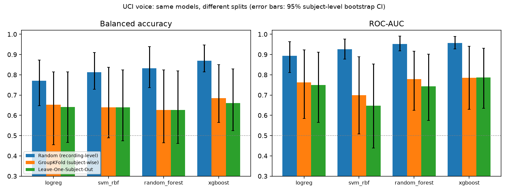

# parkinsons-screening

**Screening support, not diagnosis.** Two *independent* Parkinson's screening-support modules (voice and spiral drawing) behind one
FastAPI backend and a browser demo. The project is built around honest evaluation on small data: subject-wise splits everywhere,
balanced metrics, subject-level bootstrap CIs, calibration, explainability and robustness checks.

> **Design decision: no fusion.** Voice (UCI) and drawing (HandPD/NewHandPD) come from *different people*. A combined voice+drawing
> score would pair measurements that never belonged to the same person, so it would be fabricated. The API has no combined endpoint
> (a test enforces this) and the web demo shows two separate modules.

## Headline result: data leakage on the voice data

The UCI file has 195 recordings from **32 subject codes** (24 PD, 8 healthy; 147/48 recordings; 6-7 recordings per subject). UCI's text says 31
people; this project reports the 32 codes it measures. With a random recording-level split, **23-26 of the 32 subjects appear in both train and test**
in every fold. The same models, re-evaluated subject-wise:

| Model | Split | Balanced acc. (mean ± sd over repeats) | ROC-AUC (mean ± sd) | ROC-AUC 95% CI* |
|---|---|---|---|---|
| logreg | Random split (recordings) | 0.770 ± 0.023 | 0.894 ± 0.010 | [0.811, 0.964] |
| logreg | Subject-wise StratifiedGroupKFold | 0.652 ± 0.017 | 0.762 ± 0.028 | [0.584, 0.922] |
| logreg | Leave-one-subject-out | 0.641 ± 0.000 | 0.749 ± 0.000 | [0.565, 0.912] |
| svm_rbf | Random split (recordings) | 0.812 ± 0.024 | 0.926 ± 0.013 | [0.877, 0.977] |
| svm_rbf | Subject-wise StratifiedGroupKFold | 0.640 ± 0.028 | 0.699 ± 0.050 | [0.508, 0.890] |
| svm_rbf | Leave-one-subject-out | 0.640 ± 0.000 | 0.647 ± 0.000 | [0.438, 0.853] |
| random_forest | Random split (recordings) | 0.833 ± 0.016 | 0.952 ± 0.006 | [0.918, 0.991] |
| random_forest | Subject-wise StratifiedGroupKFold | 0.627 ± 0.018 | 0.778 ± 0.037 | [0.625, 0.917] |
| random_forest | Leave-one-subject-out | 0.626 ± 0.000 | 0.743 ± 0.000 | [0.574, 0.902] |
| xgboost | Random split (recordings) | 0.872 ± 0.019 | 0.957 ± 0.005 | [0.928, 0.988] |
| xgboost | Subject-wise StratifiedGroupKFold | 0.681 ± 0.037 | 0.786 ± 0.040 | [0.631, 0.941] |
| xgboost | Leave-one-subject-out | 0.671 ± 0.000 | 0.792 ± 0.000 | [0.631, 0.940] |

\*CI = 95% percentile CI from resampling **subjects** (1000 draws) on the repeat-averaged out-of-fold predictions, so it is centred slightly
differently from the mean over repeats. Random/GroupKFold: 10 repeats of 5-fold CV; LOSO: deterministic.
Gap (random minus subject-wise): balanced accuracy 0.12-0.21, ROC-AUC 0.13-0.23 across the four models. Chart: `experiments/results/voice/leakage_chart.png`.



## Voice: model comparison (subject-wise only)

Repeated StratifiedGroupKFold (5 folds x 10 repeats), pooled out-of-fold metrics at threshold 0.5, 95% subject-level bootstrap CIs.
Hyper-parameters are fixed and un-tuned (no selection bias from tuning). Imbalance handling: `class_weight='balanced'` (LogReg, SVM),
`'balanced_subsample'` (RF), `scale_pos_weight` computed inside each training fold (XGBoost). Imputation and scaling live in an sklearn `Pipeline`
and are fit inside each fold. `*__basic7` = 7-feature model used by the unvalidated browser demo.

| Model | #feat | Bal. acc. | ROC-AUC | PR-AUC | Sensitivity | Specificity | Brier | ECE |
|---|---|---|---|---|---|---|---|---|
| logreg | 22 | 0.634 [0.454, 0.814] | 0.764 [0.584, 0.922] | 0.913 [0.810, 0.981] | 0.769 [0.645, 0.878] | 0.500 [0.190, 0.854] | 0.192 [0.123, 0.274] | 0.183 [0.119, 0.291] |
| svm_rbf | 22 | 0.654 [0.488, 0.837] | 0.702 [0.508, 0.890] | 0.880 [0.747, 0.975] | 0.912 [0.831, 0.974] | 0.396 [0.095, 0.750] | 0.180 [0.091, 0.276] | 0.139 [0.078, 0.269] |
| random_forest | 22 | 0.633 [0.464, 0.823] | 0.778 [0.625, 0.917] | 0.924 [0.837, 0.982] | 0.912 [0.831, 0.973] | 0.354 [0.000, 0.750] | 0.154 [0.082, 0.233] | 0.127 [0.077, 0.237] |
| xgboost | 22 | 0.702 [0.566, 0.849] | 0.795 [0.631, 0.941] | 0.920 [0.820, 0.988] | 0.905 [0.825, 0.966] | 0.500 [0.250, 0.792] | 0.154 [0.082, 0.238] | 0.146 [0.089, 0.246] |
| logreg__basic7 | 7 | 0.580 [0.387, 0.776] | 0.702 [0.480, 0.910] | 0.864 [0.702, 0.978] | 0.680 [0.503, 0.842] | 0.479 [0.143, 0.833] | 0.219 [0.134, 0.308] | 0.220 [0.136, 0.350] |
| xgboost__basic7 | 7 | 0.565 [0.389, 0.771] | 0.681 [0.454, 0.888] | 0.846 [0.668, 0.977] | 0.776 [0.619, 0.914] | 0.354 [0.000, 0.750] | 0.214 [0.119, 0.311] | 0.186 [0.105, 0.323] |

**Read this honestly:** subject-wise ROC-AUC is roughly 0.70-0.80 with CIs about 0.3 wide (lower bounds near 0.5-0.6); differences between models are
well inside the noise. At the 0.5 threshold sensitivity is high but **specificity is only about 0.35-0.50** (CIs very wide, only 8 healthy subjects), i.e. models
mostly say "PD". The 7-feature browser-demo model is weaker still (AUC CIs include 0.5).

## Voice: calibration (nested, subject-wise)

The calibrator (Platt or isotonic) is fit only on inner subject-wise out-of-fold predictions inside each outer training set. 3 repeats.

| Model | Variant | ECE (mean ± sd) | Brier (mean ± sd) |
|---|---|---|---|
| logreg | raw | 0.194 ± 0.021 | 0.195 ± 0.009 |
| logreg | platt | 0.078 ± 0.014 | 0.157 ± 0.008 |
| logreg | isotonic | 0.094 ± 0.044 | 0.160 ± 0.023 |
| svm_rbf | raw | 0.135 ± 0.019 | 0.178 ± 0.012 |
| svm_rbf | platt | 0.055 ± 0.014 | 0.166 ± 0.008 |
| svm_rbf | isotonic | 0.098 ± 0.044 | 0.173 ± 0.009 |
| random_forest | raw | 0.118 ± 0.014 | 0.157 ± 0.005 |
| random_forest | platt | 0.061 ± 0.026 | 0.154 ± 0.002 |
| random_forest | isotonic | 0.097 ± 0.047 | 0.163 ± 0.007 |
| xgboost | raw | 0.149 ± 0.023 | 0.166 ± 0.019 |
| xgboost | platt | 0.102 ± 0.036 | 0.155 ± 0.004 |
| xgboost | isotonic | 0.096 ± 0.010 | 0.158 ± 0.015 |

Calibration lowers ECE and Brier for most models, but with 32 subjects (8 healthy) a reliability curve has a handful of points per bin and isotonic
regression overfits easily, so treat calibrated probabilities as approximate. Pooled AUC moved slightly (calibrated 0.68-0.76 vs raw 0.72-0.78) because each fold has its own calibrator.
Reliability plot: `experiments/results/voice/voice_reliability.png`.

## Voice: explainability and robustness

SHAP (XGBoost fit on all recordings; explains the deployed model, it is not an evaluation): top features are **PPE, spread2, MDVP:Fhi, MDVP:Fo, spread1**
(`voice_shap_top_features.csv`, `voice_shap_summary.png`). PPE/spread1/spread2 are nonlinear f0-variation measures, which is physiologically plausible
for dysphonia. But Fhi and Fo are absolute pitch levels that depend on sex and age, and UCI provides neither, so they may encode a confounder or a recording
artifact rather than disease. This cannot be tested with the data available.
Noise robustness (Gaussian noise on test features, scaled by training SD): AUC is roughly flat up to 0.5 SD and degrades at 1.0 SD (e.g. XGBoost 0.78 to 0.71).

## Drawing module

Pipeline implemented: pooled HandPD + NewHandPD loader (user-placed folders, optional `subjects.csv`, source-prefixed subject IDs), handcrafted spiral features
(spatial tremor frequency in cycles per revolution, radial deviation, curvature smoothness, ink stats), small CNN with/without augmentation, source-shortcut check,
subject-wise CV per dataset and pooled, cross-dataset train/test both ways, noise robustness, Grad-CAM with a stroke-vs-border check, and an optional
NewHandPD image+pen-signal experiment.

**No real drawing data was available when this was built, so there are NO real drawing results.** `make train` runs experiments 5-9 on a *synthetic* spiral
generator as a smoke test; everything under `experiments/results/drawing_synthetic_smoke/` is stamped
"SYNTHETIC: pipeline validation only, not scientific results." and must not be cited. The shipped drawing model is trained on synthetic data only, and the API
says so in every response. The handcrafted features were developed on synthetic spirals and are untested on real scans; expect to retune them.

To run on real data: request HandPD and NewHandPD from their owners (UNESP, Brazil; check licences), see `data/drawings/README.md`, then `make train`.

## Run it

```bash
# macOS / Linux
unzip parkinsons-screening.zip && cd parkinsons-screening
python3 -m venv .venv && source .venv/bin/activate
pip install -r requirements.txt
python data/download_data.py            # add --mirror if UCI is unreachable (third-party copy)
python -m src.voice.train && python -m src.voice.explain && python -m src.robustness
python -m src.leakage_experiment
python -m src.drawing.train
python -m uvicorn api.main:app --port 8000      # then open http://localhost:8000
python -m pytest -q
```
```bat
:: Windows (cmd)
tar -xf parkinsons-screening.zip && cd parkinsons-screening
py -3 -m venv .venv && .venv\Scripts\activate
pip install -r requirements.txt
python data\download_data.py
python -m src.voice.train && python -m src.voice.explain && python -m src.robustness
python -m src.leakage_experiment
python -m src.drawing.train
python -m uvicorn api.main:app --port 8000
python -m pytest -q
```
`make` shortcuts (macOS/Linux/WSL): `make setup data leakage train serve test lint docker`. Docker: `docker compose up --build`
(mounts `./models`; run training on the host first, or exec `make train` inside the container). Python 3.12 was used; the pinned numpy 2.x / pandas 3 need 3.11+.

## API

| Endpoint | Purpose |
|---|---|
| `GET /health` | status, loaded models, provenance (incl. whether the drawing model is synthetic-trained) |
| `POST /predict/voice-features` | JSON `{"row": "<UCI row>"}` or `{"features": {...}}`. All 22 UCI features -> real model; only the 7 basic ones -> labelled "unvalidated demo, not comparable to the training data." |
| `POST /predict/drawing` | multipart `file`; returns probability, band (low <0.35 / uncertain / elevated >0.65), "uncertain -> please retest" flag, input-quality checks |

No combined endpoint. Every response carries the disclaimer. Uploads are processed in memory, never stored. Browser audio is analysed client-side; only 7 numbers are sent.
The live-audio demo cannot be validated: UCI features come from a specific pipeline, so browser-derived values are not comparable.

## Layout
`src/` (splits, voice/, drawing/, evaluate, calibration, robustness, leakage_experiment, synthetic), `api/`, `web/`, `tests/`, `notebooks/01_leakage_demo.ipynb`,
`experiments/results/`, `models/`, `data/DATA_CARD.md`.

## Limitations
- Only 32 voice subjects (8 healthy): wide CIs, unstable specificity, unreliable calibration; no external voice validation (NeuroVoz, mPower are future work, not used).
- Class imbalance; no age/sex metadata, so pitch-level features may be confounded; single site/protocol.
- Model selection (default API model = best subject-wise AUC) used the same CV as the reported numbers, which is mildly optimistic.
- UCI mirror provenance: the sandbox could not reach UCI; use `download_data.py` to fetch the original.
- Drawing: no real-data results; synthetic-only model; heuristic features unvalidated on real images; static images have no time axis (so "tremor frequency" is spatial).
- Not a diagnostic device.
